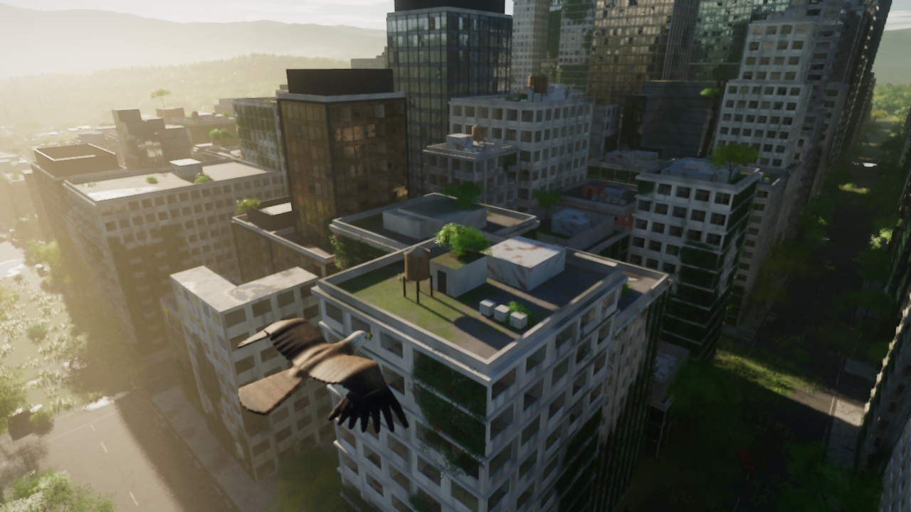
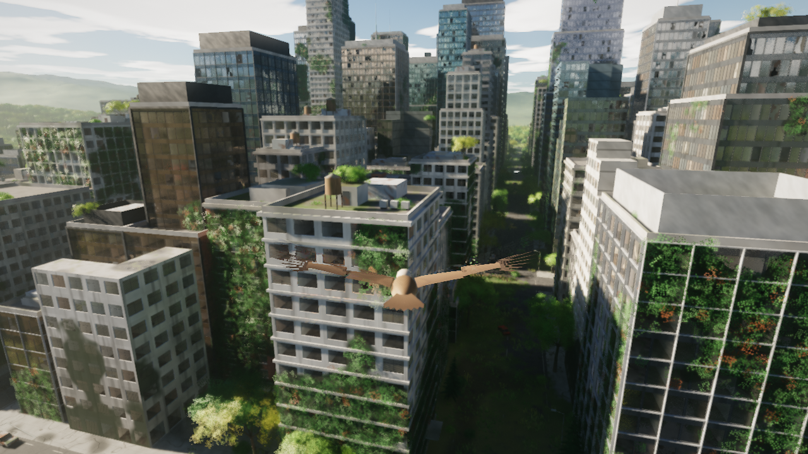
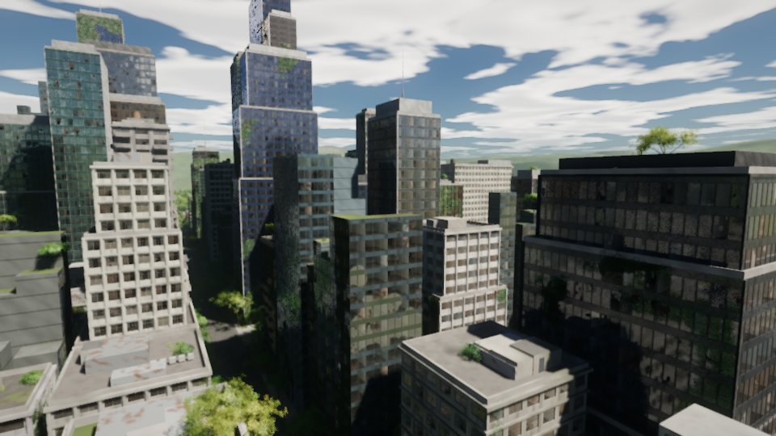
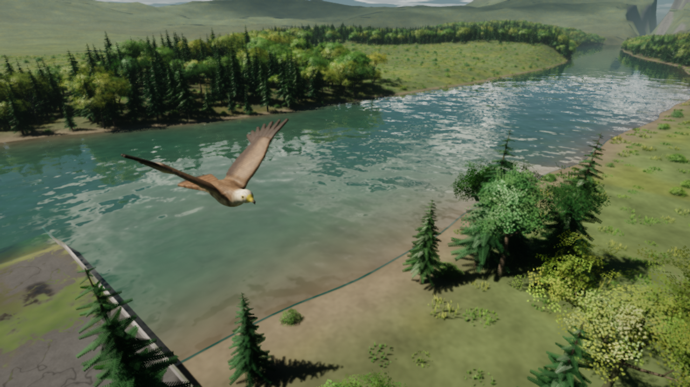
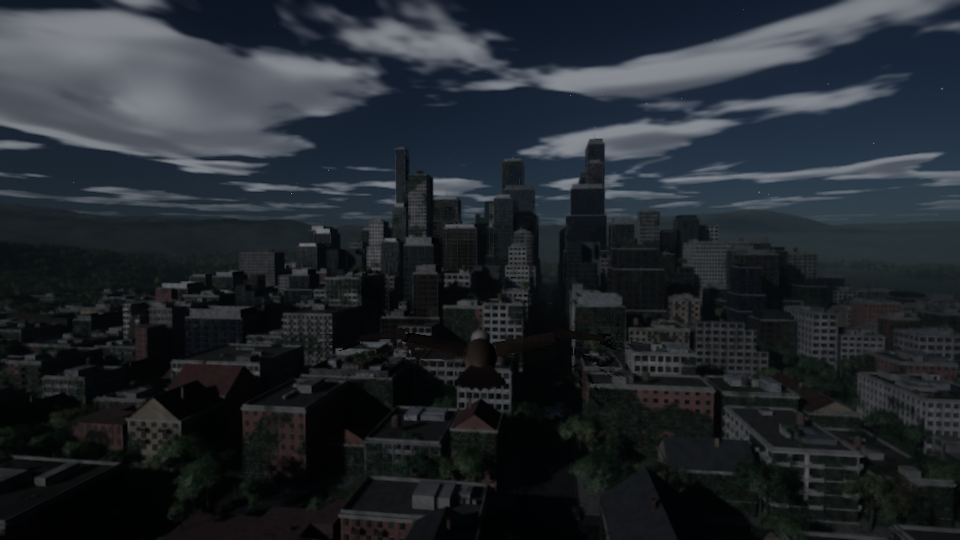

# Vogelflug

Als Vogel über eine verlassene Stadt fliegen, die sich die Natur zurückholt.
Eigene C++/Vulkan-Engine, das komplette Bild entsteht per Hardware-Raytracing (`VK_KHR_ray_query`).



| | |
|---|---|
|  |  |
|  |  |

Die Bilder stammen aus der Engine, gerendert mit einem Software-Treiber in 720p bzw. 540p.

## Starten

`Vogelflug.exe` (liegt fertig gebaut im Hauptverzeichnis dieses Repos) herunterladen und doppelklicken. Es gibt keine Installation und keine Zusatzdateien: Shader, Schrift und Welt-Generator stecken in der .exe, die Welt wird beim Start in ein paar Sekunden erzeugt.

Voraussetzungen: Windows 10/11 (64 Bit), Grafikkarte mit Hardware-Raytracing und aktuellem Treiber (entwickelt für RTX 5060 Ti 16 GB; jede RTX-Karte bzw. RX 6000+ / Arc sollte gehen). Es werden rund 2 GB Grafikspeicher belegt.

Falls etwas nicht startet: Im selben Ordner entsteht `vogelflug.log`, bei Fehlern erscheint zusätzlich ein Meldungsfenster.

## Steuerung

| Taste | Funktion |
|---|---|
| W / S | schneller / langsamer |
| A / D | nach links / rechts drehen |
| Maus | Richtung ändern, steigen und sinken |
| Q / E, Mausrad | Tageszeit zurück / vor (jederzeit) |
| 1 – 6 | Morgen, Vormittag, Mittag, Abend, Dämmerung, Nacht |
| T | Zeitablauf an / aus |
| + / − (auch Bild↑ / Bild↓) | Zeitablauf schneller / langsamer |
| N / M | weniger / mehr Wolken |
| C | Kamera: nah, weit, Ich-Perspektive |
| F1 – F4 | Qualität: Leistung, Ausgewogen, Hoch, Ultra |
| V | VSync an / aus (aus = maximale FPS) |
| F11 | Vollbild / Fenster |
| H, Tab | Hilfe, Anzeige ausblenden |
| R | zurück zum Startpunkt |
| Esc | Pause (dann X zum Beenden) |

Im Sturzflug wird der Vogel schneller, im Steigflug langsamer. Gebäude und Boden sind fest: der Vogel gleitet an Wänden entlang. Durch Baumkronen kann man hindurchfliegen.

## Was die Grafik macht

- **Raytracing für alles**: Primärstrahlen, Schatten von Sonne und Mond (weich, über die Größe der Scheibe gestreut), 1-Bounce Global Illumination, Spiegelungen auf Wasser, Fensterglas und Pfützen, volumetrischer Nebel mit Lichtschäften.
- **Tag/Nacht**: Sonnen- und Mondbahn für 48,7° Nord, physikalisch basierter Himmel (Rayleigh/Mie/Ozon), Sonnenfarbe aus der atmosphärischen Transmission, Morgennebel, Sterne, Wolken mit Wolkenschatten, automatische Belichtung.
- **Entrauschen**: zeitliche Akkumulation mit Reprojektion, À-trous-Filter, TAA, danach Bloom und ACES-Tonemapping.
- **Welt**: prozedural, rund 4,8 Mio. Dreiecke und 125 000 Instanzen. Stadt mit Hochhäusern, Ruinen, Efeu, Dachbewuchs, Autowracks und Laternen, Wald im Westen, Fluss mit eingestürzter Brücke im Süden.
- **Vogel**: ein einziges zusammenhängendes Netz (34 000 Dreiecke), aus einer geglätteten Distanzfunktion erzeugt. Für den Flügelschlag wird es pro Frame an Schulter, Handgelenk und Federspitzen gebogen und seine Raytracing-Struktur neu gebaut.
- **Gebäude**: L-förmige und gestaffelte Baukörper, Fassadenrelief (Lisenen, Geschossbänder, Gesimse, Fensterbänke, Balkone, Feuertreppen, Markisen), Satteldächer, Wassertanks, Klimageräte und Technik-Kronen. Fenster sitzen mit Parallaxe in der Wand und zeigen Innenräume (Interior Mapping). Glasfassaden spiegeln je nach Beschichtung unterschiedlich stark und farbig, jede Scheibe ist leicht verkippt und gewölbt.

Startoptionen (Verknüpfung oder Konsole): `--fenster`, `--size 1920 1080`, `--quality 0..3`, `--density 0.5` (weniger Vegetation), `--time 18.5`, `--novsync`.

## Stand der Tests

- Unter Linux mit dem Software-Vulkan-Treiber lavapipe gerendert, mit den Khronos-Validation-Layern geprüft. Einzige Meldung dort: der Vertexpuffer (263 MB) überschreitet das lavapipe-Limit von 128 MB; bei NVIDIA liegt dieses Limit bei 4 GB.
- Die Windows-.exe lief unter Wine (ebenfalls lavapipe) bis zum fertigen Bild.
- Kollisionstest: 1,5 Mio. Simulationsschritte, der Vogel landet nie in einem Gebäude.
- **Nicht getestet: echte RTX-Hardware.** Bildrate und Treiberverhalten auf der 5060 Ti sind daher ungemessen. Bei zu wenig FPS F2 oder F1 drücken.

## Selbst bauen

Linux (Ubuntu 24.04), erzeugt Linux-Binary und Windows-.exe per MinGW:

```
sudo apt install g++ cmake git glslang-tools python3-pil g++-mingw-w64-x86-64-posix \
                 libx11-dev libxrandr-dev libxinerama-dev libxcursor-dev libxi-dev
./setup_deps.sh        # volk, Vulkan-Headers, GLFW 3.4 nach ../deps
./build.sh all         # -> build/vogelflug und dist/Vogelflug.exe
```

Die .exe im Hauptverzeichnis ist eine Kopie von `dist/Vogelflug.exe` aus genau diesem Quellstand.

```
# Kollisionstest:
g++ -std=c++17 -O2 tools/test_collide.cpp src/world.cpp -o build/test_collide && ./build/test_collide
```

Unter Windows geht dasselbe in einer MSYS2-MinGW64-Shell (`glslang`, `python`, `gcc`, `glfw`), `build.sh` braucht dann nur angepasste Compiler-Namen.

## Dateien

| Datei | Inhalt |
|---|---|
| `src/main.cpp` | Vulkan-Engine, Beschleunigungsstrukturen, Render-Passes, Flugmodell, Eingabe, HUD |
| `src/world.cpp`, `world.h` | Welt-Generator (Stadt, Ruinen, Vegetation, Vogel), Kollision |
| `src/mathx.h` | Vektoren, Noise (bitgleich zur GLSL-Version) |
| `src/shaders.h`, `font.h` | generiert: eingebettete SPIR-V-Shader und HUD-Schrift |
| `shaders/rt.comp` | Raytracing: Materialien, Beleuchtung, Spiegelungen, Nebel |
| `shaders/sky.comp` | Atmosphärenmodell |
| `shaders/temporal.comp`, `atrous.comp`, `composite.comp`, `taa.comp` | Entrauschen und Zusammensetzen |
| `shaders/bloom.comp`, `exposure.comp`, `final.*` | Bloom, Belichtung, Tonemapping, HUD |
| `tools/` | Shader-Einbettung, Font-Erzeugung, Kollisionstest, Testbild-Skript |

## Lizenzen der Abhängigkeiten

GLFW (zlib), volk (MIT), Vulkan-Headers (Apache 2.0 / MIT), HUD-Schrift aus DejaVu Sans Mono (Bitstream-Vera-Lizenz). GLFW und volk sind statisch in die .exe gelinkt.
